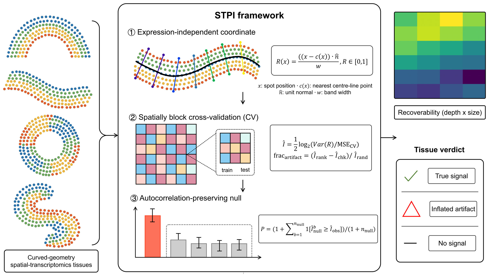

<p align="center">
  <picture>
    <source media="(prefers-color-scheme: dark)" srcset="docs/assets/stpi_banner_dark.svg">
    
  </picture>
</p>

<p align="center">
  <b>How much position does gene expression carry in a tissue section, in bits, and does that number hold up?</b>
</p>

<p align="center">
  <a href="https://www.python.org/"></a>
  <a href="LICENSE"></a>
  <a href="https://doi.org/10.5281/zenodo.24462347"></a>
  <a href="tests/"></a>
  <a href="analysis/"></a>
</p>

<p align="center">
  <a href="#-overview">Overview</a> &nbsp;&bull;&nbsp;
  <a href="#-installation">Installation</a> &nbsp;&bull;&nbsp;
  <a href="#-quick-start">Quick start</a> &nbsp;&bull;&nbsp;
  <a href="#-reproduce-the-paper">Reproduce the paper</a> &nbsp;&bull;&nbsp;
  <a href="#-data">Data</a> &nbsp;&bull;&nbsp;
  <a href="#-citation">Citation</a>
</p>

---

## ✨ Overview

**STPI** turns the question *"does gene expression encode position?"* into a number that can be
checked. 📏 It measures positional information in **bits**, decoding an expression-independent
coordinate from expression, and it attaches to every estimate the sampling and validation
conditions under which it holds.

<p align="center">
  
</p>

### 🧭 Three guards, one number

| | Guard | What it rules out | In `stpi` |
|:-:|---|---|---|
| 📐 | **① Expression-independent coordinate** | *Circularity*: position is built from tissue geometry, never learned from the expression it is decoded from | `stpi.coords`: `across_band` for thin curved bands, `interiority`, `backbone_offset`, `along_backbone`, `harmonic` |
| 🧱 | **② Spatial block cross-validation** | *Neighbour leakage*: test spots cannot borrow from adjacent training spots; an optional buffer removes training spots next to each test block | `checkerboard_folds`, `recoverability(..., buffer=...)` |
| 🎲 | **③ Autocorrelation-preserving null** | *Smoothness alone*: any smooth signal can predict a smooth coordinate | `msr_surrogates` (Moran spectral randomisation), `spin_surrogates`, `null_p` |

### 🩺 What you get for each section

| | Output | |
|:-:|---|---|
| 🗺️ | **Recoverability map** | Î (bit) across sequencing depth × pseudospot size, via `stpi.scan.size_depth_scan` |
| ✅ | **True signal** | Î exceeds the autocorrelation-preserving null and stays positive under spatial block CV |
| 🔺 | **Inflated artifact** | positive under random CV, but falls to or below zero once the folds are spatial blocks |
| ➖ | **No signal** | Î does not exceed the null |

The share of the random-CV estimate that is inflation (`frac_artifact`) is reported alongside, so
the cost of choosing the wrong validation scheme is visible for every section.

### 🌟 Highlights

- 📏 **A number in bits**, on one scale across tissues, platforms and sampling settings.
- 📐 **Geometry, not expression, defines position.** Coordinates come from spot positions alone.
- 🧱 **Leakage-aware validation**, with an adjustable buffer and a random-split arm reported beside it.
- 🎲 **A null that keeps the autocorrelation**, decoded exactly like the observed coordinate.
- ⚡ **One-call audit.** `stpi.audit_section` returns every estimate, the null P value and a verdict.
- 🔒 **Deterministic.** Every random step is seeded; results do not depend on the number of CPU threads.

## 🚀 Installation

```bash
git clone https://github.com/wcs52113140123-pixel/STPI.git
cd STPI
pip install .               # numpy, scipy, pandas, scikit-learn, threadpoolctl
pip install ".[io]"         # + h5py, to read 10x Visium .h5 matrices
pip install ".[figures]"    # + matplotlib, seaborn, pillow, to draw the figures
```

Python 3.10 or newer. No GPU is needed.

## ⚡ Quick start

```python
import stpi
from stpi import io

# a Visium section from GEO: counts (spots x genes) and spot positions
M, xy = io.read_geo_mtx("retina_GSE248517", "GSM7916286_078_A1")

R     = stpi.interiority(xy)           # 1. coordinate from geometry only
X     = stpi.log_hvg(M)                #    normalised expression, 2,000 features
folds = stpi.checkerboard_folds(xy)    # 2. 4 x 4 spatial blocks

I_block  = stpi.recoverability(X, R, folds).I
I_random = stpi.recoverability(X, R, stpi.random_folds(len(R), 5, 0)).I
I_buffer = stpi.recoverability(X, R, folds, xy, buffer=4 * stpi.spot_pitch(xy)).I

S, _ = stpi.msr_surrogates(R, xy, n_draws=200, seed=stpi.seed_of("my_section"))   # 3. null
P = stpi.null_p(I_block, [stpi.recoverability(X, s, folds).I for s in S])
```

Or all of it in one call:

```python
out = stpi.audit_section(M, xy, "my_section")
```

| Key | Meaning |
|---|---|
| `I_random`, `I_checker` | positional information (bit) under random and spatial block cross-validation |
| `frac_artifact` | share of the random-CV estimate that is inflation |
| `I_buffer_k`, `frac_dropped_k` | estimate with a buffer of *k* spot pitches, and the share of training spots it removes |
| `P`, `null_median`, `null_p95` | comparison with the autocorrelation-preserving null |
| `verdict` | `holds under the buffer`, `falls under the buffer`, `collapse` or `coordinate-limited` |

For curved, layered tissue, use `stpi.across_band(x, y)` as the coordinate. To scan sampling-unit
size and sequencing depth, use `stpi.scan.size_depth_scan`.

## 🔁 Reproduce the paper

Everything in the paper is regenerated from code in this repository.

| Goal | Command | Time |
|---|---|---|
| 🎨 Draw every figure from the tables in `results/` | `cd figures && python fig1.py` (and `fig2.py` ... `figS5.py`, `keys.py`) | minutes |
| 🧪 Regenerate every table from the raw data | `STPI_DATA=<data folder> python analysis/run_all.py -j 12` | about 50 min on 12 cores |
| ✅ Run the tests | `python -m pytest tests` (add `STPI_DATA=...` to include public-data checks) | about 1.5 min |

Two runs of `run_all.py` give identical tables. The tests check, on simulated data, that the
package recovers position when it is there and does not report it when it is not, and, on public
data, that it reproduces the tables in `results/` value for value.

<details>
<summary><b>🗂️ Repository layout</b></summary>

```
STPI/
├── src/stpi/          the package: coordinates, folds, decoding, nulls, audit, readers
├── analysis/          scripts that write results/ from raw data; run_all.py runs them in order
├── results/           result tables behind every figure (CSV, NPZ, JSON)
├── data_derived/      two geometry-only files (meninges coordinates by stage), no expression
├── figures/           one script per figure, reading only results/ and data_derived/
├── tests/             simulated-data and public-data checks
└── docs/              README images
```

`analysis/README.md` lists every script, what it writes and which figure uses it.
`figures/README.md` lists the inputs of each figure script.
</details>

<details>
<summary><b>📁 Expected layout of <code>STPI_DATA</code></b></summary>

```
STPI_DATA/
├── gw6_annotated/  gaston_gw16/  gaston_multi/     human fetal meninges (controlled access)
├── skin_GSE245179/                                 injured mouse tendon
├── kidney_GSE273978/   intestine_GSE245274/   cerebellum_GSE296375/
├── retina_GSE248517/   retina_GSE309408_finch/
└── derived/            MERFISH metadata; tendon inputs (written by analysis/, or from Zenodo)
```
</details>

## 🧬 Data

| Dataset | Used in | Access |
|---|---|---|
| Human fetal meninges, Stereo-seq and MERFISH, GW6 to GW16 | Fig 1 to 3 | Li *et al.* 2026, *Cell* 189:4756-4774; controlled access as stated there (human genetic resource data, not redistributed) |
| Injured mouse tendon, Visium | Fig 4 | GEO [GSE245179](https://www.ncbi.nlm.nih.gov/geo/query/acc.cgi?acc=GSE245179); preprocessed inputs on [Zenodo](https://doi.org/10.5281/zenodo.24462347) |
| Mouse kidney, intestine, cerebellum and retina; finch retina | Fig 5 | GEO [GSE273978](https://www.ncbi.nlm.nih.gov/geo/query/acc.cgi?acc=GSE273978), [GSE245274](https://www.ncbi.nlm.nih.gov/geo/query/acc.cgi?acc=GSE245274), [GSE296375](https://www.ncbi.nlm.nih.gov/geo/query/acc.cgi?acc=GSE296375), [GSE248517](https://www.ncbi.nlm.nih.gov/geo/query/acc.cgi?acc=GSE248517), [GSE309408](https://www.ncbi.nlm.nih.gov/geo/query/acc.cgi?acc=GSE309408) |

The result tables in `results/` contain coordinates, estimates and summary statistics only; no
expression matrix of the human data is included.

## 📖 Citation

Citation details for the accompanying paper will be added on publication. To cite the
code and result tables:

```bibtex
@software{stpi_2026,
  title   = {STPI: spatial transcriptomic positional information},
  author  = {Wei, Changsheng and Ni, Jiayao and Li, Yanxin},
  version = {1.0.1},
  year    = {2026},
  doi     = {10.5281/zenodo.24462347},
  url     = {https://doi.org/10.5281/zenodo.24462347}
}
```

## 📄 License

Code is released under the [MIT License](LICENSE).
